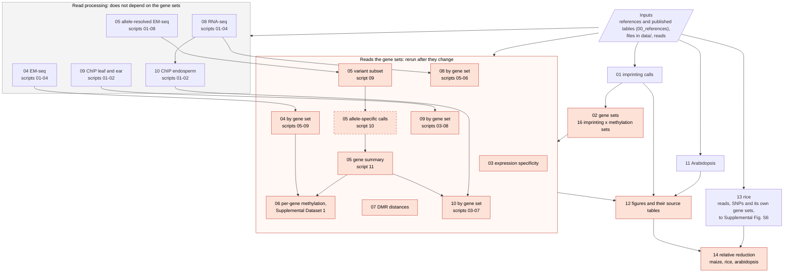

# Maternal repression of imprinted genes in endosperm by gene body demethylation: code

Every analysis, figure and number in the paper, from public data. Scripts are numbered in the
order they run: module folders `scripts/00_*` to `scripts/14_*`, and numbered scripts inside
each. Each script's header lists what it reads, with the public source of every external file,
and what it writes. [NUMBERS.md](NUMBERS.md) maps each number in the text to the script and file
that produce it.

## Setup

The analysis was run on a Windows 11 workstation under WSL 2 (Windows Subsystem for Linux 2.7.3),
in Ubuntu 26.04 LTS, with conda. The figures and many of the downstream tables were first made
with Python on Windows; for release the pipeline was rerun under WSL, and the paper's figures are
the WSL versions (see Verification). The figures use Arial; install it
first (for example the `ttf-mscorefonts-installer` package, or copy `arial*.ttf` into
`~/.local/share/fonts`).

One input has to be downloaded by hand, because PNAS does not serve it to scripts: Dataset S1 of
Bewick et al. 2016 (https://doi.org/10.1073/pnas.1604666113, Supporting Information,
`pnas.1604666113.sd01.xlsx`). Save it as
`$GI_RUN/data/arabidopsis/supplementary/pnas.1604666113.sd01.xlsx`;
`scripts/11_arabidopsis/01_download.sh` checks it and stops with these instructions if it is
missing.

```bash
bash envs/setup_envs.sh          # five conda environments, with the methylpy and BS-Seeker2 patches (below)
export GI_RUN=/path/with/space   # downloads, intermediates and results all go here
./run_all.sh                     # everything, in order
./run_all.sh scripts/02_gene_sets                    # one module
./run_all.sh scripts/02_gene_sets/03_build_sets.py   # one script
```

`config.sh` sets the paths (`GI_DATA`, `GI_WORK`, `GI_RESULTS` under `GI_RUN`) and threads
(`GI_THREADS`, default 8). Figures and tables land in `$GI_RUN/results/{figures,tables}`, and
each script's log in `$GI_RUN/logs`.

## Skipping the read mapping

Mapping the EM-seq libraries takes weeks on one workstation, the rice WGBS libraries about eight
days, and the RNA-seq alignment about a day and a half. The processed files they produce are on
Zenodo ([DOI to be added]). To start from them:

| Zenodo files | Place as |
|---|---|
| `allc_<sample>_merged.tsv.gz` (8 files) | `$GI_WORK/04_emseq_methylation/allc/` |
| `<library>.<context>.asm.tsv` (18 files) | `$GI_WORK/05_allele_methylation/asm/` |
| `endosperm_snv.vcf.gz` | `$GI_WORK/05_allele_methylation/snv/endosperm_snv.vcf` (decompressed) |
| `libs.tsv` | `$GI_WORK/05_allele_methylation/libs.tsv` |
| `rnaseq_counts/<run>.{B73,Mo17}.txt.gz` (24 files) | `$GI_WORK/08_rnaseq_allele/counts/<run>.{B73,Mo17}.txt` (decompressed), with an empty `<run>.done` beside each run's pair |
| `rice/meth/<run>.genome{1,2}.bismark.cov.gz` (16 files) | `$GI_WORK/13_rice/meth/` |
| `rice/qc/` (the per-library reports) | `$GI_WORK/13_rice/qc/` |
| `rice/snps_{KAS,9311}.txt` (not needed below; to map without calling SNPs) | `$GI_WORK/13_rice/snps/` |

```bash
./run_all.sh scripts/00_references scripts/01_imprinting_calls scripts/02_gene_sets \
             scripts/03_expression_specificity
./run_all.sh scripts/04_emseq_methylation/0[5-9]_*
./run_all.sh scripts/05_allele_methylation/09_asm_snv_subset.py \
             scripts/05_allele_methylation/11_gene_summary.py
./run_all.sh scripts/06_per_gene_methylation scripts/07_dmr_distances \
             scripts/08_rnaseq_allele/05_maternal_fraction.py scripts/08_rnaseq_allele/06_delta_by_class.py \
             scripts/09_chip_leaf_ear scripts/10_chip_endosperm_allele scripts/11_arabidopsis \
             scripts/12_figures
./run_all.sh scripts/13_rice/01_download_references.sh scripts/13_rice/0[6-9]_* \
             scripts/13_rice/10_figS6.py scripts/14_relative_reduction
```

HISAT2's spliced alignment is not deterministic, so RNA-seq counts regenerated from the reads
(all of module 08) differ from the Zenodo tables by one fragment in about 1% of genes, which moves
some Figure 3c values in their last digit. The ChIP-seq arms (modules 09, 10) reproduce exactly
from reads, in hours.

## Disk space

Space each module took in our run, downloads included, in GB:

| Module | From the reads | From the Zenodo files |
|---|---|---|
| `00_references` | 7 | 7 |
| `04_emseq_methylation` | 310: reads 165, BAMs 58, methylation calls 63, bisulfite index 6, tables 19 | 41 |
| `05_allele_methylation` | 310: reads 141, BAMs 142, index 14, ATCGmaps 13 | 1 |
| `08_rnaseq_allele` | 100 at peak: reads 53, genome, index and SNPs 11, allele BAMs 12, plus 23 for the sample being aligned | under 1 |
| `09_chip_leaf_ear` | 3 | 3 |
| `10_chip_endosperm_allele` | 40: reads 28, working files 12 | 40 |
| `13_rice` | 1,210: reads 176, BAMs 976, resequencing BAMs 47, reference and indexes 6, methylation calls 2 | 2 |
| the other modules | under 1 | under 1 |

About 2 TB in all from the reads, 95 GB from the Zenodo files. methylpy leaves each library's
BAM beside its methylation calls; nothing downstream reads them, so they can be deleted once
`04_emseq_methylation/03_map.sh` has finished. The same holds for the rice BAMs once
`13_rice/05_map_libraries.sh` has finished (about 120 GB per library, most of it intermediate
copies: before and after deduplication, and per allele).

## Modules

| Module | Methods section |
|---|---|
| `00_references` | genomes, annotations, cross-references; published maize tables |
| `01_imprinting_calls` | Identification of imprinted maize genes |
| `02_gene_sets` | Assignment of maize genic DNA methylation categories |
| `03_expression_specificity` | Maize gene expression specificity calculations |
| `04_emseq_methylation` | Methylation calling, metagene methylation, and per-gene methylation |
| `05_allele_methylation` | Allele-resolved maize DNA methylation |
| `06_per_gene_methylation` | per-gene and per-region comparisons; Supplemental Dataset 1 |
| `07_dmr_distances` | Maize DMR distances |
| `08_rnaseq_allele` | Maize RNA-seq read processing, mapping and allele-specific counts |
| `09_chip_leaf_ear` | Maize ChIP-seq: leaf and ear |
| `10_chip_endosperm_allele` | Maize ChIP-seq: allele-resolved endosperm |
| `11_arabidopsis` | Arabidopsis methods; Supplemental Dataset 3 |
| `12_figures` | every figure panel and its source table, except Supplemental Fig. S6 |
| `13_rice` | Rice methylation: gene sets, allele-resolved endosperm methylation, Supplemental Fig. S6; Supplemental Dataset 2 |
| `14_relative_reduction` | the relative maternal reduction quoted for maize, rice and arabidopsis |

## How the modules connect



The shaded steps, in the lower box and the figures, read the gene sets directly or through another
shaded step, so they are the ones to rerun after the gene sets change. The allele-specific calls
(dashed) depend on the gene sets only through the variant subset, which covers the union of the
16 sets: they need rerunning only if that union changes. The read processing, in the grey box,
does not depend on the gene sets. `03_expression_specificity` writes numbers quoted in the text,
not a figure. The rice module takes its gene sets from its own inputs (`13_rice/06_gene_sets.py`),
not from the maize ones.

## Rerunning after an input changes

The long steps skip work whose output already exists: the EM-seq mapping alone takes weeks, and
an interrupted run can then be started again where it stopped. The flip side is that after an
input changes, a step whose output is already there keeps its old result, and its log only notes
that it skipped. This happened in our own rerun after the gene sets were redefined (see
Verification). Either run into an empty `GI_RUN`
(with `GI_DATA` pointing at the earlier run's `data/`, so nothing is downloaded twice), or delete
the outputs of these steps first. For a change to the gene sets they are:

| Step | Outputs to delete |
|---|---|
| `04_emseq_methylation/06_region_hits.sh` | `$GI_WORK/04_emseq_methylation/violin/*_hits.tsv` |
| `04_emseq_methylation/08_metagene_per_gene.sh` | `$GI_WORK/04_emseq_methylation/metagene/*_metagene_cg_fixed_pergene.tsv` |
| `04_emseq_methylation/09_metagene_by_context.py` | `$GI_WORK/04_emseq_methylation/metagene/*_metagene_bycontext_pergene.tsv` |
| `06_per_gene_methylation/03_control_region_deltas.sh` | `$GI_WORK/06_per_gene_methylation/ctrl_*.tsv` |
| `09_chip_leaf_ear/04_count.sh` | `$GI_WORK/09_chip_leaf_ear/counts/*.counts.tsv`, `*.total.txt` |
| `09_chip_leaf_ear/07_metagene_count.sh` | `$GI_WORK/09_chip_leaf_ear/bincounts/*.bincounts.tsv` |
| `10_chip_endosperm_allele/06_compact_counts.sh` | `$GI_WORK/10_chip_endosperm_allele/counts_allele_compact/*.bincounts.tsv` |
| `05_allele_methylation/10_asm.sh`, only if the union of the sets changed | `$GI_WORK/05_allele_methylation/asm/*.asm_done` |

Then rerun every shaded step in the chart above. Every other script downstream of the gene sets
rewrites its output on each run. In the rice module the cached steps (`03` to `05`) depend only on
the reads, the reference and the SNPs; `06` onwards rewrite their outputs on each run.

## Figures

Some scripts and images keep the supplement numbers they had when they were written, so the
image names are given too.

| Figure | Scripts (last step) | Images (`$GI_RESULTS/figures`) |
|---|---|---|
| 1a | `lib/timecourse.py`; `12_figures/01_fig1.py` | `fig1_compact` |
| 1b, 1c | `12_figures/01_fig1.py` | `fig1_compact` |
| 2a-d | `04_emseq_methylation/07_metagene_bins.sh`, `08_metagene_per_gene.sh`; `12_figures/02_fig2_metagene_table.py`, `03_fig2.py` | `fig2p_ad` |
| 2e | `05_allele_methylation/11_gene_summary.py`; `12_figures/03_fig2.py` | `fig2p_e` |
| 2f, 2g | `07_dmr_distances/01_prep_beds.py` to `03_distance_stats.py`; `12_figures/03_fig2.py` | `fig2p_f` with its key `fig2p_f_key`, `fig2p_g` |
| 3a | `04_emseq_methylation/06_region_hits.sh`; `06_per_gene_methylation/01_supplemental_dataset1.py` to `04_control_deltas_summary.py`; `12_figures/05_fig3.py` | `fig3p_a` |
| 3b, 3c | `08_rnaseq_allele/02_build_snps.sh` to `05_maternal_fraction.py`; `12_figures/05_fig3.py` | `fig3p_b`, `fig3p_c` |
| 4 | `10_chip_endosperm_allele/02_align_split_count.sh` to `07_compact_profile.py`; `12_figures/06_fig4.py` | `fig4i_a` to `fig4i_j`; the paper has all gbM-biparentals in b and g and the demethylated subset in c and h, the reverse of the images' letters |
| 5 | a drawn model, no script | |
| S1 | `09_chip_leaf_ear/01_download.sh` to `08_metagene_profile.py`; `12_figures/10_figS1.py` | `figS1_h3k27me3` |
| S2 | `04_emseq_methylation/06_region_hits.sh`; `06_per_gene_methylation/01_supplemental_dataset1.py`; `12_figures/14_fig_endo_embryo.py` | `figS_endo_embryo_mcg` |
| S3 | `04_emseq_methylation/09_metagene_by_context.py`; `12_figures/11_figS2.py` | `figS2_chg_chh` |
| S4 | `04_emseq_methylation/06_region_hits.sh`; `06_per_gene_methylation/01_supplemental_dataset1.py` to `04_control_deltas_summary.py`; `12_figures/12_figS3.py` | `figS3_mature` |
| S5 | `lib/timecourse.py`; `12_figures/13_figS4.py` | `figS_matpref_by_methylation` |
| S6a-d | `13_rice/01_download_references.sh` to `08_metagene.py`; `13_rice/10_figS6.py` | `rice_matpat_metagene` |
| S6e | `13_rice/01_download_references.sh` to `07_gene_matpat.py`; `13_rice/10_figS6.py` | `rice_matpat_violins` |
| S7a-d | `11_arabidopsis/01_download.sh`, `07_gene_targets.py`; `12_figures/15_fig_arabidopsis_metagene.py` | `figS_ara_ad` |
| S7e, S7f | `11_arabidopsis/08_paternal_allele_methylation.py`, `09_dme_fie_methylation.py`; `12_figures/09_fig5cde.py` | `fig5p_c`, `fig5p_d` |

Also drawn, for panels no longer in the paper: `12_figures/04_fig2_supp_matpat_metagene.py`
(maize maternal and paternal metagenes), `03_fig2.py`'s `figS_matpat_violins`, `08_fig5b.py`
(arabidopsis maternal and paternal metagenes) and `09_fig5cde.py`'s `fig5p_e` (fie).

## Tool fixes the results depend on

* **methylpy 1.4.7** (`envs/patches/methylpy.patch`, applied by `setup_envs.sh`): it passes
  cutadapt a `-f` option that cutadapt removed in 2.0, so unpatched every trimming call fails
  and no library is mapped, and Picard 3 MarkDuplicates fails on its BAMs, which have no read
  group. The patch drops the option (and `--quality-base 33`, cutadapt's default) and adds a
  default read group before MarkDuplicates.
* **BS-Seeker2 2.1.7** (`envs/patches/bs_seeker2-call_methylation.patch`, applied by
  `setup_envs.sh`): its pysam pileup call drops read pairs without the proper-pair flag, which
  BS-Seeker2 never sets, and bases without qualities, which it never writes, so unpatched it
  writes empty ATCGmap files and exits 0. The patch restores the pysam 0.7.7 behaviour the tool
  was written for.
* **CGmapTools** is not packaged; `setup_envs.sh` checks out the exact commit used (afa6e40,
  v0.1.3) and links its tools as its installer does. Its `asm` subcommand calls whichever
  `samtools` and `R` are on PATH; the environment pins the versions used.

## Environments

Every tool and package version used is pinned in `envs/*.yml`.

## Data

`data/` holds the small inputs that ship with the code; `data/README.md` gives the source of
each.

## Verification

Before release the pipeline was run again under WSL, in an empty directory, from the scripts' own
downloads and with the environments built from `envs/`, and its results compared with the
paper's.

* Every source table and legend number, and Supplemental Dataset 1, came out identical (p-values
  to within 1e-20), except the allele-resolved metagene supplement's (below). Figure 3 is drawn
  from the Zenodo RNA-seq counts; counts regenerated from the reads differ slightly (see
  "Skipping the read mapping").
* The paper's figures were first drawn with Python on Windows; they have been replaced by the ones
  this rerun drew under WSL. Most are pixel-identical to the Windows versions. In Figure 2 and the
  allele-resolved violin supplement some labels moved by a pixel, because the Windows renders had
  ticks 0.5 pt longer than the script specifies, and the allele-resolved metagene supplement and
  its source table changed by at most 0.0006: where two calls for one cytosine have the same
  coverage, its script keeps whichever pandas' default sort puts first, and that order differs
  between platforms.
* The methylation classes were then redefined (Zeng et al. 2023's rules, with at least 10 covered
  CG and CHG sites) and every step that reads the gene sets was run again in the same directory.
  The paper's tables and figures were remade under WSL too, by the analysis scripts they came
  from; against them every source table, legend number and Supplemental Dataset 1 came out
  identical to within floating-point rounding, and all 29 figures pixel-identical. The union of
  the gene sets did not change, so neither did the variants the allele-specific calls are made
  at, and those calls were not repeated. Two of the steps listed under "Rerunning after an input
  changes", the control-region methylation (`06_per_gene_methylation/03_control_region_deltas.sh`)
  and the allele-resolved H3K27me3 bin counts (`10_chip_endosperm_allele/06_compact_counts.sh`),
  had first kept their outputs from the old gene sets, so Figure 3a's control and Figure 4 still
  showed old values; the comparison caught it, and once those outputs were deleted and the steps
  rerun, they matched.
* Mapping all the EM-seq reads takes weeks, so it was repeated on the first million read pairs of
  one library for each method. Every read methylpy and BS-Seeker2 kept aligned exactly as in the
  paper's BAMs (379,228 and 462,482 reads); methylpy also kept 22,629 reads that the full library
  had removed as PCR duplicates of reads outside the subset. BS-Seeker2's methylation calling for
  one of the pooled BAM's sequence sets, the variant calling in full (5,158,268 variants) and the
  allele-specific calling at 400 variants gave the paper's results, apart from a date in the VCF
  header and the allele-specific FDR, which is adjusted over all the rows of a run.
* One run of each EM-seq dataset, downloaded by the scripts, gave the paper's FASTQ files read for
  read; the RNA-seq and endosperm ChIP-seq reads matched ENA's checksums.
* The four environments, built again from an empty conda package cache, reproduced the outputs of
  methylpy, BS-Seeker2, CGmapTools, the R imprinting calls and Figure S5 on test inputs.
* The rice module and the relative reductions were added later (October 2026) and checked the same
  way. From the per-allele coverage files of the paper's run (the Zenodo files), with the reference
  and Tonosaki et al.'s tables downloaded by the scripts (byte-identical to the paper's by sha256 and
  md5), every rice table, Supplemental Fig. S6 and the three relative reductions came out identical
  (figures pixel-identical), and the stated category rules reproduced every category of the shipped
  leaf table.
* Mapping the eight rice WGBS libraries takes about eight days, so the read processing
  (`13_rice/02` to `05`) was repeated on subsets. NCBI's md5 and size for all 12 runs matched the
  paper's downloads, and one resequencing run downloaded by the script was byte-identical. The SNP
  calling, from the paper's duplicate-marked resequencing BAMs, gave identical VCF records and SNP
  lists. On the first million read pairs of each resequencing run, every pair kept by trimming
  aligned as in the paper's BAMs, and the N-masked genomes were identical. On the first million
  read pairs of DRR425631 and DRR425633, Bismark aligned every pair as in the paper's BAMs (756,319
  and 767,174 pairs), and SNPsplit assigned the same allele to every pair that deduplication kept
  in both runs (664,208 and 670,952). These tests ran in the environment of the paper's rice run,
  which was not rebuilt; `envs/gi_rice.yml` solves to the same version and build of every tool it
  pins.

## License

The code is released under the MIT license (see `LICENSE`). Two parts are other people's work
and keep their own terms:

* The patches in `envs/patches/` modify methylpy (Apache License 2.0) and BS-Seeker2 (MIT
  license) and are distributed under those projects' licenses.
* The files in `data/` that come from other sources keep those sources' terms; `data/README.md`
  gives the source of each.

The processed files deposited at Zenodo are released under CC BY 4.0.
